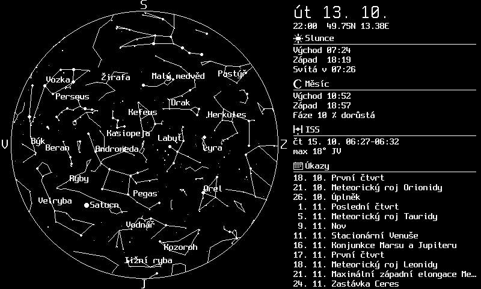

# Sky – aktuální obloha pro e-paper

Malá HTTP služba (a CLI), která podle GPS souřadnic a směru vykreslí **aktuální
oblohu** – souhvězdí, planety, Slunce, Měsíc s fází a ISS – a vedle ní infopanel
s východy a západy, nejbližším viditelným přeletem ISS a kalendářem úkazů.
Výstup je **PNG nebo BMP** v paletě **BW / BWR / BWRY**, libovolný rozměr na šířku
i na výšku, bez vyhlazování – přímo pro e-paper (Živý obraz, Paperboard, …).

Přes den (Slunce nad obzorem) se kreslí světlý režim: bílé pozadí, černé čáry,
Slunce, Měsíc a planety, které jsou právě nad obzorem. V noci tmavý režim.



## Rychlý start

```bash
pip install .                       # nebo pip install -e .[dev] pro vývoj
python -m sky warmup                # stáhne efemeridu de421.bsp (~17 MB) do ./cache
python -m sky render --lat 49.747 --lon 13.378 --out obloha.png
python -m sky serve --port 8080     # http://127.0.0.1:8080/sky.png?lat=49.747&lon=13.378
```

## Nastavení v prohlížeči

Na kořenové adrese služby (`/`) je konfigurační stránka: naklikáte stanoviště,
pohled, rozměr a paletu panelu, čas pro náhled a obsah, vidíte živý náhled
přesně v pixelech panelu a zkopírujete hotovou adresu pro Živý obraz.
Nastavení si pamatuje prohlížeč. Stránka je určená pro veřejnou instanci bez
tokenu; adresu služby si bere z adresy, na které běží.

## HTTP rozhraní

```
GET /                      # konfigurační stránka
GET /sky.png?lat=49.747&lon=13.378&az=180&view=sky&w=800&h=480&colors=bw
GET /sky.bmp?lat=49.747&lon=13.378&view=horizon&az=200&fov=120&colors=bwry&w=480&h=800
GET /health
```

| parametr | hodnoty | význam | výchozí |
|---|---|---|---|
| `lat`, `lon` | −90..90, −180..180 | stanoviště (WGS84) | env `SKY_LAT`/`SKY_LON`, jinak povinné |
| `view` | `sky` \| `horizon` | celá obloha (kruh, zenit uprostřed) nebo pohled z okna | `sky` |
| `az` | 0..360 | `sky`: azimut dole (co máte před sebou); `horizon`: střed pohledu | `180` (jih) |
| `fov` | 30..180 | jen `horizon`: šířka zorného pole ve stupních | `120` |
| `w`, `h` | 64..2000 | rozměr v px; poměr stran určuje rozložení | `800`, `480` |
| `colors` | `bw` \| `bwr` \| `bwry` \| `spectra` | paleta: červeně planety, ISS a dnešní úkaz; žlutě Slunce; `spectra` (6 barev) navíc zelenou ISS. Měsíc, obzor a texty jsou vždy černobílé | `bw` |
| `rot` | 0 \| 90 \| 180 \| 270 | otočení hotového obrázku po směru hodin | `0` |
| `t` | ISO 8601 nebo `HH:MM` | čas vykreslení; bez zóny = UTC; roky 1900–2050 (rozsah efemeridy). `HH:MM` = dnes v tento místní čas stanoviště (např. `t=22:00`: panel přes den ukazuje dnešní večerní oblohu) | teď |
| `mode` | `auto` \| `night` \| `day` | režim podle Slunce, nebo vynucený tmavý / světlý | `auto` |
| `weather` | 0 \| 1 | oblačnost na noc v sekci Slunce (Open-Meteo): průměr, převládající vrstva (vysoké cirry jasné objekty propustí, nízká a mlha ne) a hodina s nejmenší nízkou oblačností | `1` |
| `ecliptic` | 0 \| 1 | tečkovaná ekliptika (u `spectra` modrá) | `1` |
| `equator` | 0 \| 1 | čárkovaný nebeský rovník (stejná barva jako ekliptika); lze mít obě čáry naráz | `0` |
| `constnames` | 0 \| 1 | názvy souhvězdí na mapě | `1` |
| `comets` | 0 \| −5..15 | komety s odhadovanou jasností do této magnitudy (6 = pouhé oko, 8 = triedr, 10 = malý dalekohled); `0` vypne | `6` |
| `sunmoon` | 0 \| 1 | popisky „Slunce“ a „Měsíc“ u jejich symbolů na mapě | `0` |
| `starnames` | −2..4,5 | jména jasných hvězd do této magnitudy (např. `2.5` ≈ 90 hvězd na celé obloze, Vega, Arktur, Polárka…); bez parametru vypnuto | – |
| `iss`, `events` | 0 \| 1 | vypnutí sekce ISS / úkazů | `1` |
| `rockets` | 0 \| 1 | starty raket (Launch Library 2) v seznamu úkazů, s časem startu | `0` |
| `lines` | `solid` \| `dashed` \| `dotted` | spojnice souhvězdí plné, čárkované, tečkované (menší kontrast) | `solid` |
| `lang` | `cs` \| `en` | jazyk popisků a textů | `cs` |
| `token` | | povinný, když je nastaven `SKY_TOKEN` | – |

Přípona určuje formát: `.png` je indexované PNG s paletou v barvách panelu
(1 bit pro `bw`, 2 bity pro `bwr`/`bwry`, 4 bity pro `spectra`), `.bmp` je 1 bpp
pro `bw` a 8 bpp indexované pro ostatní. Pořadí barev v paletě: bílá, černá,
červená, žlutá, modrá, zelená. Pozor: v 1bpp BMP je podle konvence Pillow/Windows index 0 černá a
1 bílá (opačně než v PNG paletě); firmware má číst paletu z hlavičky. Odpověď
nese hlavičku `X-Sky-Mode: night|day`. Služba nezapisuje access log (URL nese
token); každé vykreslení loguje jeden řádek bez parametrů. Chybné parametry
vrací 400 s popisem, špatný token 403, chybějící efemerida 503.

Hotové obrázky se cachují v paměti 5 minut (`SKY_RENDER_CACHE_S`); TLE a ICS se
stahují nejvýš jednou za den a při výpadku sítě se použije poslední stažená
verze. Vykreslení trvá zhruba 0,6 s.

## CLI

```bash
python -m sky render --lat 49.747 --lon 13.378 [--view sky|horizon] [--az 180] [--fov 120]
                     [--w 800] [--h 480] [--colors bw|bwr|bwry] [--rot 0] [--t 2026-10-13T22:00+02:00]
                     [--no-iss] [--no-events] [--lang cs|en] --out obloha.png|obloha.bmp
python -m sky serve [--host 127.0.0.1] [--port 8080]
python -m sky warmup
```

## Konfigurace (env)

| proměnná | význam | výchozí |
|---|---|---|
| `SKY_CACHE_DIR` | adresář pro efemeridu, TLE a ICS | `./cache` |
| `SKY_LAT`, `SKY_LON` | výchozí stanoviště | – |
| `SKY_TOKEN` | když je nastaven, vyžaduje se `?token=` | – |
| `SKY_EVENTS_URL` | ICS kalendář úkazů | sdílený kalendář Jana Tichého |
| `SKY_TLE_URL` | zdroj TLE pro ISS | Celestrak, NORAD 25544 |
| `SKY_ROCKETS_URL` | JSON nadcházejících startů (Launch Library 2) | `ll.thespacedevs.com/2.2.0/launch/upcoming/` |
| `SKY_WEATHER_URL` | základ URL předpovědi (Open-Meteo forecast API) | `api.open-meteo.com/v1/forecast` |
| `SKY_COMETS_URL` | dráhové elementy komet (MPC, pevný formát CometEls.txt) | `minorplanetcenter.net/iau/MPCORB/CometEls.txt` |
| `SKY_RENDER_CACHE_S` | TTL cache hotových obrázků v sekundách | `300` |
| `SKY_EVENT_TYPES` | typy úkazů k zobrazení: `eye,scope,warn,moon,none,info` | `eye,scope,warn,moon` |
| `SKY_RATE_LIMIT` | nejvýš tolik požadavků na `/sky.*` za minutu z jedné IP (429 při překročení); `0` vypne | `60` |
| `SKY_TRUST_PROXY` | `1` = IP klienta z poslední položky `X-Forwarded-For` (za reverzní proxy, např. Coolify); `cloudflare` = navíc `CF-Connecting-IP`, ale jen když požadavek přišel z rozsahů Cloudflare | `0` |

## Nasazení v Coolify

1. Nový zdroj typu **Dockerfile** (repozitář nebo vložený obsah `Dockerfile`).
2. **Persistent Storage**: volume → `/cache` (efemerida, TLE, ICS přežijí redeploy).
3. **Port**: `8080`.
4. **Environment Variables**: pro soukromou instanci `SKY_TOKEN`
   (`php -r "echo bin2hex(random_bytes(16));"`); pro veřejnou instanci (např.
   `sky.makerclass.cz`) token nenastavujte, ochranou je limit `SKY_RATE_LIMIT`
   (výchozí 60 požadavků za minutu na IP) a paměťová cache hotových obrázků.
   V Coolify nastavte `SKY_TRUST_PROXY=1`, aby se IP brala z `X-Forwarded-For`
   doplněné proxy; bez proxy hlavičku nechte ignorovat, klient si ji může podvrhnout.
   Za Cloudflare použijte `SKY_TRUST_PROXY=cloudflare`: skutečný klient se bere
   z `CF-Connecting-IP`, ale jen když požadavek přišel z IP rozsahů Cloudflare
   (jinak by všichni návštěvníci sdíleli pár adres edge serverů a limit by padal
   na všechny). Ideálně navíc omezte přístup k originu jen na Cloudflare a
   přidejte limit i v Cloudflare (WAF rate limiting), ten chrání i před špičkami,
   které k aplikaci vůbec nedojdou. Volitelně `SKY_LAT`, `SKY_LON`.
5. Health check: `GET /health` → `{"status": "ok", "ephemeris": "ok"}`.

Lokálně:

```bash
docker build -t sky-epaper .
docker run --rm -p 8080:8080 -e SKY_TOKEN=tajne sky-epaper
curl "http://localhost:8080/sky.png?lat=49.747&lon=13.378&token=tajne" -o obloha.png
```

## Zapojení do Živého obrazu

Otevřete konfigurační stránku služby (např. `https://sky.makerclass.cz/`),
naklikejte panel a zkopírujte adresu. V administraci Živého obrazu pak nastavte
zdroj **obrázek z URL** a adresu vložte, např.

```
https://sky.makerclass.cz/sky.png?lat=49.747&lon=13.378&az=200&w=800&h=480&colors=bw
```

Server Živého obrazu musí na službu dosáhnout z internetu. Pro BWR/BWRY panely
použijte odpovídající `colors`; obrázek je už v barvách panelu, dithering není
potřeba. Paperboard firmware (`[remote_image]`) umí stejné PNG z LAN.

## Co je na obrázku

- **Mapa**: hvězdy do 4,5 mag (velikost podle jasnosti), čáry a názvy souhvězdí (`constnames=0` je skryje;
  všechny popisky mají 1px obrys v barvě pozadí, aby byly čitelné přes čáry),
  volitelně jména jasných hvězd (`starnames`) a popisky Slunce a Měsíce (`sunmoon`),
  Merkur až Neptun (Uran a Neptun prázdným kroužkem, jsou jen pro dalekohled),
  Měsíc s fází natočenou ke Slunci, Slunce je-li nad obzorem, tečkovaná ekliptika (volitelně
  i čárkovaný nebeský rovník),
  ISS je-li nad obzorem a hodinu před viditelným přeletem jeho čárkovaná dráha
  s časem začátku a konce, komety jasnější než `comets` mag (jádro s ohonem od Slunce a jménem;
  odhad jasnosti z dráhových elementů bývá přesný jen na 1–2 mag). `sky` je azimutální mapa (obzor = kružnice, světové strany kolem),
  `horizon` je panorama azimut × výška s obzorem dole.
- **Infopanel**: datum a čas, Slunce (východ, západ, konec občanského soumraku / začátek
  občanského svítání (−6°) a astronomická noc „Tma od–do“ (−18°, kdy je opravdu tma), oblačnost na noc
  s převládající vrstvou: nízká / střední / vysoká / mlha a nejlepší hodinou podle nízké oblačnosti),
  Měsíc (východ, západ, fáze), ISS (nejbližší viditelný přelet do 48 h: nad 10°,
  osvětlená, za občanského soumraku), úkazy (dalších 12 z kalendáře, dnešní
  zvýrazněný; volitelně i starty raket s časem). U `horizon` dostane infopanel
  jen výšku, kterou zobrazené sekce potřebují (úkazy aspoň 6 řádků), zbytek
  připadne obloze; na šířku je hlavička jednořádková. Na malé panely jde jen mapa.

## Zdroje dat a licence

- Hvězdy, čáry a názvy souhvězdí, jména hvězd: [d3-celestial](https://github.com/ofrohn/d3-celestial)
  (BSD-3, `sky/data/LICENSE-d3-celestial`); hvězdy z katalogu XHIP, čáry podle IAU,
  jména hvězd (IAU) zkrácená na hvězdy do 4,5 mag v `sky/data/starnames.json`.
- Efemerida JPL DE421 a výpočty: [Skyfield](https://rhodesmill.org/skyfield/) (MIT).
- Dráha ISS: TLE z [Celestrak](https://celestrak.org/).
- Oblačnost: [Open-Meteo](https://open-meteo.com/) (CC BY 4.0, bez klíče, nekomerční použití
  zdarma do ~10 000 požadavků denně). Souřadnice se zaokrouhlují na 0,05° a předpověď se
  cachuje hodinu, takže i veřejná instance s mnoha panely dělá jen desítky dotazů za hodinu.
  Pro komerční provoz je potřeba jejich placený tarif. Weather data by Open-Meteo.com.
- Komety: [Minor Planet Center](https://www.minorplanetcenter.net/iau/MPCORB/CometEls.txt)
  (dráhové elementy všech sledovaných komet, bez klíče, cache 24 h); poloha přes Skyfield,
  jasnost odhadem m = H + 5·log Δ + 2,5·G·log r.
- Starty raket: [Launch Library 2](https://thespacedevs.com/llapi) (The Space Devs), bez klíče,
  anonymně 15 dotazů za hodinu; služba se ptá nejvýš jednou za 6 hodin. Proběhlé starty a
  starty bez potvrzeného data se nezobrazují.
- Kalendář úkazů: sdílený český kalendář nebeských úkazů Jana Tichého,
  [jantichy.cz/ukazy](https://www.jantichy.cz/ukazy). Licence není uvedena;
  určeno pro soukromé displeje, při zveřejnění uveďte zdroj.
- Fonty: [Spleen](https://github.com/fcambus/spleen) (BSD-2, `sky/fonts/LICENSE`).

## Vývoj

```bash
pip install -e .[dev]
python -m sky warmup            # testy označené `ephem` potřebují de421.bsp v ./cache
python -m pytest -q
```

Architektura: čisté moduly (`params`, `palette`, `projection`, `layout`, `fonts`,
`icons`, `geo`, `catalog`, `events`) bez IO; `astro` (Skyfield), `iss` a
`events` se síťovou cache (`netcache`); `render` kreslí do Pillow obrazu
v režimu `P`; `output` kóduje PNG/BMP; `service` skládá pipeline s cache;
`app` (FastAPI) a `cli` jsou tenké obálky. Návrh je v
`docs/superpowers/specs/2026-10-13-sky-epaper-design.md`.
